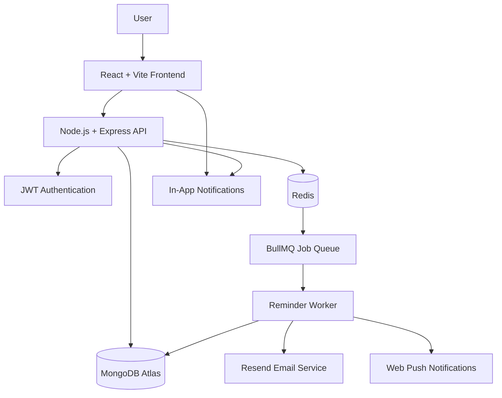

 <div align="center">


# TaskFlow

### Plan Your Day. Focus on What Matters. Achieve More.

**A modern, full-stack productivity platform designed to help you organize tasks, manage projects, build better habits, and achieve your goals.**

[](https://taskflow-web-xyub.onrender.com/)
[](https://taskflow-api-t19t.onrender.com/api/health)
[](https://github.com/nvaltryek-001/TASKFLOW-)

**Organize Better • Focus Deeper • Accomplish More**

</div>

---

## 🌐 Live Application

| Component | Link |
|---|---|
| **Live Website** | https://taskflow-web-xyub.onrender.com/ |
| **Backend API** | https://taskflow-api-t19t.onrender.com/ |
| **API Health Check** | https://taskflow-api-t19t.onrender.com/api/health |
| **GitHub Repository** | https://github.com/nvaltryek-001/TASKFLOW- |

> **Hosting note:** The application uses Render's free-tier hosting. Services may sleep after inactivity, so the first request can take approximately 50 seconds or more to respond.

## 📖 About TaskFlow

TaskFlow is a full-stack smart productivity and task management application that brings essential productivity tools together in one unified workspace.

Instead of switching between multiple applications, users can manage their daily activities, organize projects, write notes, track productivity, schedule reminders, and monitor personal goals from a single platform.

The application combines a responsive React frontend with a Node.js backend, MongoDB database, and Redis-powered background job processing.

### 🎯 Project Objectives

- Simplify everyday task and project management.
- Improve productivity through structured planning.
- Encourage focused work using Pomodoro sessions.
- Track progress through goals and analytics.
- Automate reminders and notifications.
- Provide a responsive experience across desktop and mobile devices.

---

## ✨ Key Features

### 📋 1. Advanced Task Management
- Create, update, delete, and organize tasks.
- Four priority levels: Low, Medium, High, and Urgent.
- Task deadlines, tags, estimated duration, and status.
- Recurring tasks: daily, weekdays, weekly, and monthly.
- Search, sorting, and filtering options.

### 📝 2. Smart Notes
- Rich-text editing experience.
- Bold, italic, underline, headings, and lists.
- Highlighting and color labels.
- Pin important notes.
- Automatic saving and content sanitization.

### ⏱️ 3. Focus & Time Tracking
- Pomodoro productivity timer.
- Configurable focus and break sessions.
- Stopwatch functionality.
- Manual time-entry tracking.
- Record focus sessions against tasks.

### 🔔 4. Smart Reminders & Notifications
- Schedule custom date-and-time reminders.
- Email reminders through Resend.
- Browser push notifications.
- In-app notification center.
- Reminder cancellation and snoozing.
- Redis and BullMQ background scheduling.
- Duplicate reminder prevention.

### 📅 5. Calendar Management
- Day, week, and month calendar views.
- Visual task scheduling.
- Track upcoming deadlines.
- Organize activities by date.

### 🎯 6. Goals & Productivity
- Set daily and weekly goals.
- Monitor goal completion.
- Track productivity progress.
- Connect goals with everyday activities.

### 📊 7. Analytics Dashboard
- Visualize productivity trends.
- Monitor completed and pending tasks.
- Review activity statistics.
- Understand productivity patterns.

### 🎨 8. Modern User Experience
- Clean and modern interface.
- Light, dark, and system themes.
- Responsive desktop and mobile layouts.
- Mobile-friendly navigation.
- Secure authentication and user-specific data.

---

## 🛠️ Technology Stack

| Layer | Technologies |
|---|---|
| Frontend | React 18, TypeScript |
| Build Tool | Vite |
| Styling | Tailwind CSS |
| State Management | Zustand |
| Backend | Node.js, Express.js |
| Backend Language | TypeScript |
| Database | MongoDB Atlas, Mongoose |
| Queue & Background Jobs | Redis, BullMQ |
| Authentication | JWT |
| Email Service | Resend |
| Push Notifications | Web Push |
| Testing | Vitest, Supertest |
| Deployment | Render |

---

## 🏗️ System Architecture

TaskFlow follows a client-server architecture with dedicated database, background job, and notification services.



### Architecture Overview

1. **Frontend:** React provides the user interface and communicates with the backend through REST APIs.
2. **Backend:** Express handles authentication, business logic, task operations, and application services.
3. **Database:** MongoDB Atlas stores user accounts, tasks, notes, reminders, goals, and activity records.
4. **Queue:** Redis and BullMQ manage background reminder jobs.
5. **Notifications:** Resend handles email delivery, while Web Push and the in-app notification system provide additional notification channels.

### Reminder Processing Workflow

1. The user creates a reminder.
2. The backend stores the reminder in MongoDB.
3. A background job is scheduled through BullMQ.
4. When the reminder becomes due, the worker processes it.
5. The notification is delivered through the configured channels.
6. Delivery status is recorded in the database.

---

## 🔐 Security & Reliability

TaskFlow includes several security and reliability measures:

- JWT-based authentication.
- User-specific data access.
- Password hashing.
- Server-side validation.
- Sanitized rich-text content.
- Environment-based secret management.
- Duplicate reminder prevention.
- Reminder delivery status tracking.

**Important:** Production credentials and API keys must be stored in backend environment variables, never committed to GitHub or exposed in frontend code.

---

## 🚀 Deployment Architecture

The application is deployed using Render.

| Service | Deployment | Configuration |
|---|---|---|
| TaskFlow Web | Render Static Site | React production build |
| TaskFlow API | Render Web Service | Node.js backend |
| MongoDB | MongoDB Atlas | Cloud database |
| Redis | Render Key Value | Background job processing |
| Email | Resend | Email delivery |

### Live Backend Health

The backend health endpoint:

https://taskflow-api-t19t.onrender.com/api/health

Verified connection status at deployment:

- MongoDB: Connected
- Email: Configured
- Web Push: Configured
- Scheduler: BullMQ

---

## ⚙️ Environment Configuration

### Backend Environment Variables

Configure these in the backend service environment settings.

| Variable | Purpose |
|---|---|
| `MONGODB_URI` | MongoDB Atlas connection |
| `JWT_SECRET` | Authentication token security |
| `RESEND_API_KEY` | Email service API key |
| `EMAIL_FROM` | Email sender address |
| `CLIENT_ORIGIN` | Frontend origin for CORS |
| `REDIS_URL` | Redis connection |
| `VAPID_PUBLIC_KEY` | Web Push public key |
| `VAPID_PRIVATE_KEY` | Web Push private key |
| `VAPID_SUBJECT` | Web Push contact identity |

### Frontend Environment Variable

```env
VITE_API_URL=https://taskflow-api-t19t.onrender.com
```

Never expose backend secrets through frontend environment variables.

---

## 💻 Run Locally

### Prerequisites

Install the following:

- Node.js 22 or compatible version
- npm
- Git
- MongoDB Atlas account or local MongoDB
- Redis (optional for local background queue processing)

### 1. Clone the Repository

```bash
git clone https://github.com/nvaltryek-001/TASKFLOW-.git

cd TASKFLOW-
```

### 2. Configure the Backend

```bash
cd server

npm install
```

Create a `.env` file using the provided example:

```powershell
Copy-Item .env.example .env
```

Configure the required environment variables in `server/.env`.

### 3. Start the Backend

```bash
npm run dev
```

### 4. Configure the Frontend

Open a second terminal:

```bash
cd TASKFLOW-/client

npm install
```

Create the frontend `.env` file if required:

```env
VITE_API_URL=http://localhost:4000
```

### 5. Start the Frontend

```bash
npm run dev
```

Open the local frontend URL displayed by Vite, usually:

http://localhost:5173/

---

## 🧪 Testing & Build

### Backend

```bash
cd server

npm test
npm run build
```

### Frontend

```bash
cd client

npm run typecheck
npm run build
```

---

## 📡 API Documentation

The backend exposes REST API endpoints for the application's core features.

| Method | Endpoint | Description |
|---|---|---|
| POST | `/api/auth/register` | Register a new account |
| POST | `/api/auth/login` | Authenticate a user |
| GET | `/api/auth/me` | Retrieve user profile |
| PATCH | `/api/auth/me` | Update profile |
| PATCH | `/api/auth/settings` | Update preferences |
| GET | `/api/auth/integrations` | Check integrations |
| GET / POST | `/api/tasks` | List or create tasks |
| PATCH / DELETE | `/api/tasks/:id` | Update or delete a task |
| GET / POST | `/api/notes` | List or create notes |
| PATCH / DELETE | `/api/notes/:id` | Update or delete notes |
| GET / POST | `/api/reminders` | List or schedule reminders |
| POST | `/api/reminders/:id/cancel` | Cancel reminder |
| POST | `/api/reminders/:id/snooze` | Snooze reminder |
| GET / POST | `/api/notifications` | Notifications |
| GET / POST / DELETE | `/api/time` | Time tracking |
| GET / POST / PATCH / DELETE | `/api/goals` | Goal management |
| GET | `/api/analytics?days=14` | Productivity analytics |
| GET | `/api/health` | Backend health status |

Authenticated endpoints require:

```http
Authorization: Bearer YOUR_JWT_TOKEN
```

---

## 📁 Project Structure

```text
TASKFLOW-/
│
├── client/
│   ├── public/
│   │   ├── icon.svg
│   │   └── service-worker files
│   │
│   └── src/
│       ├── components/
│       ├── pages/
│       ├── store/
│       ├── lib/
│       └── assets/
│
├── server/
│   ├── src/
│   │   ├── models/
│   │   ├── routes/
│   │   ├── services/
│   │   ├── middleware/
│   │   └── index.ts
│   │
│   ├── test/
│   ├── package.json
│   └── tsconfig.json
│
├── README.md
└── .gitignore
```

---

## 🗺️ Future Improvements

Potential enhancements for future releases:

- Google Calendar integration.
- AI-powered task recommendations.
- Advanced productivity insights.
- Team collaboration and shared workspaces.
- Calendar synchronization.
- Advanced reporting and exports.
- Native mobile application.

---

## 🤝 Contributing

Contributions, ideas, bug reports, and feature suggestions are welcome.

1. Fork the repository.
2. Create a feature branch.
3. Make your changes.
4. Test your implementation.
5. Submit a pull request.

---

## 📄 License

This project is available for educational and development purposes. Add an appropriate open-source license file if you intend to distribute it under a specific license.

---

<div align="center">

## 💜 TaskFlow

### Plan Your Day. Focus on What Matters. Achieve More.

**Built to make everyday productivity simpler, smarter, and more organized.**

[🌐 Open TaskFlow](https://taskflow-web-xyub.onrender.com/) · [💻 GitHub Repository](https://github.com/nvaltryek-001/TASKFLOW-)

</div>
